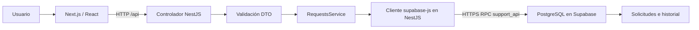

# Arquitectura y decisiones

## Flujo de una operación

El proxy de Next.js reenvía `/api` al backend. El navegador no recibe la clave secreta. El controlador expone HTTP, el DTO valida entradas, el servicio selecciona la operación y el adaptador Database llama a Supabase.

## Por qué funciones SQL

Una actualización del estado y su historial deben confirmarse juntas. Dos llamadas independientes del SDK podrían guardar solo una de esas partes. Por eso se invoca una función SQL mediante RPC: toda la llamada es una transacción PostgreSQL. Si falla la inserción del historial, se revierte la actualización.

`support_api` admite exclusivamente health, list, detail, history, create, update y status. No recibe SQL libre. El orden usa expresiones de una lista cerrada y los filtros se pasan como parámetros.

Las reglas definitivas de transición se ejecutan en la función, junto con `SELECT ... FOR UPDATE`. El bloqueo de la fila obliga a un segundo cambio concurrente a evaluar el estado actualizado. Las ayudas del frontend mejoran la experiencia, pero no sustituyen esas comprobaciones.

## Modelo

`support_requests`: UUID, título, descripción, solicitante, categoría, prioridad, estado y fechas con zona horaria.

`request_history`: identificador secuencial, referencia a solicitud, clase de evento, estados anterior/nuevo, responsable, observación y diferencias de campos en JSONB. La clave foránea evita historiales huérfanos. Se conservan registros; no se ofrece borrado físico.

Las fechas se generan en la base y la interfaz las muestra en el huso horario del navegador.

## Supuestos del enunciado

- Solo se permiten las tres transiciones expresamente adoptadas: Pendiente a En progreso, En progreso a Resuelta y Pendiente a Cancelada.
- Resuelta y Cancelada son finales y sus campos no se editan, para conservar el contexto del cierre.
- No se agrega cancelación desde En progreso porque no se necesita para satisfacer el mínimo definido.
- El solicitante y el responsable son nombres escritos por el usuario; no hay sistema de usuarios autenticados.
- La creación se audita con el solicitante como responsable; las ediciones y transiciones requieren un responsable explícito.
- La búsqueda trata el texto como una subcadena literal; `%` y `_` no son comodines.
- Prioridad ordena por nivel: Crítica, Alta, Media y Baja.
- Los filtros se combinan con AND. La búsqueda encuentra coincidencias en cualquiera de sus tres campos.
- El listado permite de 1 a 100 elementos por página; la interfaz usa 8.

## Seguridad y operación

RLS está habilitado y no se crean políticas públicas. Se revoca la ejecución de RPC a PUBLIC, anon y authenticated y se concede a service_role, usado por las claves secretas. La función usa SECURITY INVOKER: sus privilegios son los del llamador.

NestJS valida tipos, longitudes, valores, UUID y parámetros, y rechaza campos extra. PostgreSQL añade restricciones. Los errores del proveedor se traducen sin devolver credenciales al navegador.

La clave secreta puede acceder al proyecto: no es una credencial para frontend. No se registra en Git ni se imprime en los diagnósticos. El backend actual escucha en loopback, para uso local.

## Mejoras futuras

Autenticación y roles, identidad verificada del responsable, pruebas de concurrencia contra PostgreSQL completo, auditoría de acceso, índices de búsqueda para grandes volúmenes y despliegue separado de frontend/backend. No se presentan como funcionalidades ya implementadas.

## Ampliación de imágenes y frontend

El formulario envía la imagen inicial junto con los datos de la solicitud. El backend valida el archivo, lo sube al bucket privado y llama a create con la referencia. La fila y su evento Creación se insertan en una transacción. Si la llamada falla, se intenta eliminar el archivo subido. Los cambios posteriores de imagen usan image y generan Edición; el registro inicial no se presenta como una edición.

La ruta frontend/app/page.tsx contiene la entrada a SupportDashboard. Los componentes RequestForm, RequestFilters, RequestList, RequestHistory y RequestImage separan presentación e interacción. Los helpers de API, conexión y procesamiento de imágenes están en frontend/lib.

El arranque local espera la salud de NestJS antes de iniciar Next.js. Para Vercel, se usan dos proyectos del mismo repositorio y un proxy configurado con API_URL. Consultar VERCEL.md.
